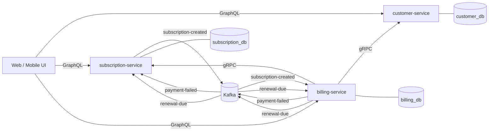

# AboSass

A backend platform that bills customers automatically for cloud services. A customer subscribes to a plan, uses the service, and the platform generates invoices, charges payments, handles failures, and issues credits, all without manual work.

This README explains **what the system does, how it is organised, and how to work on it**. If you are new to the project, read it top to bottom once.

---

## 1. The big picture (in plain words)

Think of a cloud provider (like a hosting company):

1. A **customer** (a person or a company) signs up.
2. They choose a **plan** (e.g. Basic, Pro) which has a **price** and **features**.
3. They get a **subscription** to that plan. They may also consume things that are billed by usage (storage, API calls...). That is the **usage**.
4. Every billing period (monthly or yearly), the system creates an **invoice** = plan price + usage charges.
5. The system tries to collect the **payment**. If it fails, it retries later. After too many failures the subscription is suspended.
6. If we owe the customer money (refund, error), we issue a **credit** (*avoir*), which is deducted from a future invoice.

The platform automates steps 4 to 6.

---

## 2. Architecture

Three independent Spring Boot services. Each one owns its own data.



| Service | Responsibility | Main entities |
|---|---|---|
| **customer-service** | Who the customers are | Customer, Company, Contact, BillingAddress |
| **subscription-service** | What they subscribed to and consumed | Subscription, Plan, Feature, Usage |
| **billing-service** | What they owe and what they paid | Invoice, Payment, Renewal, Credit |

There is also a **contracts** module shared by all services. It holds the `.proto` files (gRPC) and the Kafka event definitions.

### The three communication rules

This is the most important thing to remember. Every piece of communication follows one of these rules:

| Who talks to whom | Technology | Why |
|---|---|---|
| **User interface to a service** | **GraphQL** | The UI asks for exactly the data it needs, in one request. |
| **Service to service, immediate answer needed** | **gRPC** | Fast, strongly typed contracts. |
| **Service to service, "something happened"** | **Kafka events** | Services stay decoupled; no one waits for anyone. |

Do **not** add REST endpoints for the UI, and do **not** call another service's database. REST is only kept for technical things (health checks, webhooks).

### Other rules of the house

- **One database per service.** No shared tables, no cross-service joins. Services reference each other **by ID only** (e.g. an invoice stores a `customerId`, not a foreign key to the customer table).
- Money is always `BigDecimal` with an explicit currency. Never `double`.
- Dates are stored in UTC.
- Entities are never exposed directly; we use DTOs and mappers.

---

## 3. Tech stack

- Java `17`, Spring Boot `3.5.6`
- Spring for GraphQL (UI-facing API)
- gRPC (service-to-service) with Protobuf
- Apache Kafka (events)
- MySQL 8 (InnoDB), Flyway migrations
- Spring Batch + Quartz (scheduled recurring billing)
- Spring Security with JWT
- Resilience4j (timeouts, retries, circuit breaker on gRPC calls)
- Testcontainers (MySQL, Kafka) for integration tests
- Docker and Docker Compose

---

## 4. Repository layout

```
.
├── contracts/               # .proto files + shared Kafka event classes
├── customer-service/
├── subscription-service/
├── billing-service/
├── docker/
│   └── mysql/init.sql       # creates the 3 databases and users
├── docs/
│   ├── AUDIT.md             # what existed vs. what was added
│   └── ASSUMPTIONS.md       # decisions taken when the spec was unclear
├── docker-compose.yml
└── README.md
```

Inside each service, the layout is the same:

```
src/main/java/.../
├── domain/        # JPA entities and enums
├── repository/    # Spring Data repositories
├── service/       # business logic (this is where the rules live)
├── graphql/       # GraphQL resolvers (UI entry point)
├── grpc/          # gRPC server implementations and clients
├── messaging/     # Kafka producers and consumers
├── dto/ mapper/   # DTOs and mappers
└── config/        # security, Kafka, gRPC, batch configuration
src/main/resources/
├── graphql/*.graphqls   # GraphQL schema
├── db/migration/        # Flyway SQL migrations
└── application.yml
```

---

## 5. Domain model

### customer-service
- **Customer**: the account owner. Can be linked to a **Company**.
- **Company**: legal entity, has many **Contacts**.
- **Contact**: a person to reach at the company.
- **BillingAddress**: where invoices are addressed. A customer can have several.

### subscription-service
- **Plan**: a pricing offer (price, currency, period: monthly/yearly).
- **Feature**: a capability included in plans. Plan and Feature are many-to-many.
- **Subscription**: a customer's link to a plan, with a status and billing dates.
- **Usage**: a consumption record (metric, quantity, timestamp) tied to a subscription.

### billing-service
- **Invoice**: amount owed for one period, made of lines (plan price + usage).
- **Payment**: one attempt to collect an invoice. An invoice can have several (retries).
- **Renewal**: the upcoming renewal of a subscription period.
- **Credit** (*avoir*): money owed back to the customer, applied to invoices.

### Lifecycles (state machines)

**Subscription:** `TRIALING → ACTIVE → PAST_DUE → SUSPENDED → CANCELLED`

**Invoice:** `DRAFT → ISSUED → PAID` or `FAILED` or `VOID`

---

## 6. How the main flows work

### 6.1 A new subscription
1. The UI calls the GraphQL mutation `createSubscription` on subscription-service.
2. The service saves the subscription and publishes **`subscription-created`** on Kafka.
3. billing-service consumes the event and creates the **first invoice**.
4. For that, it calls customer-service (gRPC) to get the billing address, and subscription-service (gRPC) to get the plan price.

### 6.2 Recurring billing (the batch)
Every day (cron configurable in `application.yml`), billing-service runs the Spring Batch job `recurringBillingJob`:
1. **Read**: asks subscription-service (gRPC) for active subscriptions due today.
2. **Process**: computes the amount = plan price + usage charges for the period (minus credits if any).
3. **Write**: creates the invoice, attempts the payment, publishes events.

A second step scans for subscriptions ending soon and publishes **`renewal-due`** a few days before the period ends.

An admin can also trigger a run manually with the GraphQL mutation `triggerBillingRun`.

### 6.3 A failed payment (dunning)
1. The payment is refused by the gateway.
2. billing-service retries on a schedule (for example D+1, D+3, D+7).
3. Each failure publishes **`payment-failed`**.
4. subscription-service consumes it and moves the subscription to `PAST_DUE`, then `SUSPENDED` after the last retry.

### 6.4 Kafka topics

| Topic | Produced by | Consumed by | Meaning |
|---|---|---|---|
| `subscription-created` | subscription-service | billing-service | A new subscription exists; create the first invoice |
| `payment-failed` | billing-service | subscription-service | A payment failed; update the subscription status |
| `renewal-due` | billing-service (batch) | billing-service, subscription-service | A renewal is coming; prepare it |

Every event carries `eventId`, `occurredAt`, and `version`. Consumers are **idempotent** (they store processed `eventId`s), so receiving the same event twice is safe. Failed messages go to a dead-letter topic (`<topic>.DLT`).

### 6.5 Payments
Payments go through a `PaymentGateway` interface. For now, a **mock implementation** is used (success/failure is configurable for tests). To plug a real provider, implement the interface; no other code changes.

---

## 7. APIs

### GraphQL (UI)
Each service exposes `/graphql`. In the dev profile, GraphiQL is available at `/graphiql`.

Example (customer-service):

```graphql
query {
  customer(id: "<uuid>") {
    id
    name
    billingAddresses { street city country }
  }
}
```

Example (billing-service):

```graphql
mutation {
  triggerBillingRun { jobExecutionId status }
}
```

Schemas live in `src/main/resources/graphql/*.graphqls`. Read them: they are the best documentation of what the UI can do.

### gRPC (internal only)

| Service | Methods |
|---|---|
| `CustomerGrpcService` | `GetCustomer`, `ValidateCustomer`, `GetBillingAddress` |
| `SubscriptionGrpcService` | `GetSubscription`, `GetActiveSubscriptionsDue`, `GetUsageForPeriod`, `UpdateSubscriptionStatus` |
| `BillingGrpcService` | `GetInvoiceStatus`, `CreateInvoiceForSubscription` |

Contracts are in `contracts/src/main/proto`. **If you change a `.proto`, only add fields; never rename or reuse field numbers**, otherwise other services break.

---

## 8. Running the project

### Prerequisites
- JDK `17`
- Maven `4.0.0`
- Docker and Docker Compose

### Start everything
```bash
docker compose up --build
```

This starts MySQL (3 databases), Kafka, and the three services.

| Component | Port |
|---|---|
| customer-service | `<8081>` |
| subscription-service | `<8082>` |
| billing-service | `<8083>` |
| MySQL | `3306` |
| Kafka | `9092` |

Health check: `http://localhost:<port>/actuator/health`

### Run one service locally (for development)
```bash
docker compose up mysql kafka -d
cd billing-service
./mvnw spring-boot:run -Dspring-boot.run.profiles=dev
```

The `dev` profile loads seed data (plans, features, a demo customer).

### Configuration
Everything is in `application.yml`, with `dev`, `test`, and `prod` profiles. Secrets (DB password, JWT keys) come from **environment variables**. Never commit them.

---

## 9. Database and migrations

- MySQL 8, one schema per service: `customer_db`, `subscription_db`, `billing_db`.
- Schema changes are made **only through Flyway migrations** in `src/main/resources/db/migration` (`V<number>__description.sql`). Never edit a migration that is already merged; add a new one.
- Hibernate runs with `ddl-auto=validate`, so a mismatch between entities and migrations fails at startup.
- Spring Batch and Quartz tables are also created through Flyway.

---

## 10. Security

- GraphQL endpoints are protected by **JWT** (Spring Security resource server).
- Roles: `ADMIN` (everything, including manual billing runs) and `CUSTOMER` (own data only).
- gRPC calls between services are internal and secured with a shared interceptor token (mTLS in prod).
- A `correlationId` is propagated through GraphQL, gRPC, and Kafka headers so one request can be traced across all services in the logs.

---

## 11. Testing

```bash
./mvnw verify
```

- **Unit tests**: business logic (proration, usage billing, credits).
- **Integration tests**: Testcontainers with a real MySQL and Kafka (no H2).
- **GraphQL tests**: `GraphQlTester`. **gRPC tests**: in-process server.
- **Batch test**: `JobLauncherTestUtils`.
- **End-to-end scenario**: create customer → create subscription → first invoice → payment fails → subscription becomes `PAST_DUE`.

All tests must pass before you open a pull request.

---

## 12. Working on the project (conventions)

1. Create a branch from `master`: `feature/<short-name>`.
2. Keep to the three communication rules (section 2).
3. New table or column? Add a Flyway migration.
4. New gRPC method? Update the `.proto` in `contracts`, rebuild, then implement.
5. New Kafka event? Define it in `contracts`, make the consumer idempotent, and configure the DLT.
6. Add or update tests with your change.
7. Open a pull request; at least one review is required.

### Where do I start?
- Read `docs/AUDIT.md` and `docs/ASSUMPTIONS.md` to understand past decisions.
- Run `docker compose up` and play with GraphiQL.
- Follow one flow (section 6.1) through the code: resolver → service → Kafka producer → consumer → gRPC call.

---

## 13. Glossary

| Term | Meaning |
|---|---|
| **Plan** | A pricing offer customers can subscribe to |
| **Subscription** | A customer's active link to a plan |
| **Usage** | Metered consumption billed on top of the plan price |
| **Proration** | Partial charge/refund when a plan changes mid-period |
| **Credit / Avoir** | Money owed back to a customer, applied to an invoice |
| **Dunning** | The process of retrying failed payments |
| **DLT** | Dead-letter topic: where Kafka messages that failed repeatedly go |
| **Idempotent** | Safe to process twice with the same result |
